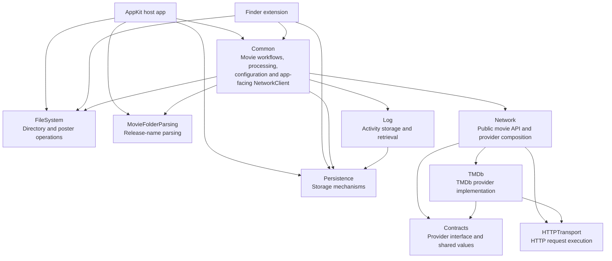
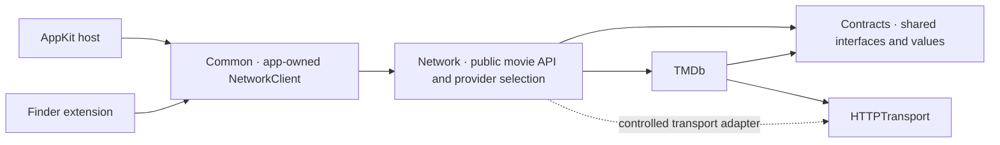

# Application architecture

This document records the agreed target architecture for Movie Folder Posters.
[Project structure](PROJECT_STRUCTURE.md) describes the repository layout, and the
[network boundary plan](NETWORK_BOUNDARY_IMPLEMENTATION_PLAN.md) records refactor progress.
A target boundary described here may still need implementation.

## Modules and contracts

A module owns a cohesive capability. It exposes a small public API through protocols,
operations, and value types. Callers depend on that contract. The module owns the choice
of algorithms, frameworks, storage mechanisms, and other implementation details behind it.
A contract specifies behavior as well as signatures, including errors, cancellation,
ordering, and ownership when callers rely on them.

Keep dependencies explicit, directed, and acyclic. Put a contract with the module that
owns its requirements. When independently built modules need to implement and consume
the same contract, put it in a small shared module that does not depend on either side's
implementation. Use constructor injection and explicit composition to choose concrete
implementations. Give each module tests for its public behavior and add boundary tests
where two modules exchange data. Add modules and protocols when there is a responsibility
or substitution boundary that justifies them.

These rules apply to Network, FileSystem, Persistence, Log, parsing, and future modules.
An application feature can use an existing service as its boundary. Feature folders and
separate compiled modules serve different purposes.

## Shared services, managers, and providers

The same dependency rules apply throughout the app. A service exposes a capability. A
manager owns a resource or state with a defined lifetime. A provider supplies data or
evidence through a contract. Choose the name that describes the responsibility and
make ownership explicit. When a feature needs only part of a service, inject a narrow
capability that fits the caller. Use a feature adapter when it translates app models or
applies feature policy.

| Capability | Module or app responsibility | Contract boundary |
|---|---|---|
| Network | Requests, provider selection, and normalized results | Feature clients use the app-owned `NetworkClient`. Network composes providers through shared contracts. |
| Logging | Generic activity recording and retrieval | The Log module owns storage mechanics. The app owns movie activity categories, privacy rules, request history meaning, and presentation. |
| Filesystem | Directory authorization, inventory, file operations, and poster icon mechanics | FileSystem encapsulates platform APIs. The app decides which authorized folders to process, when to assign an icon, and what to do when access changes. |
| Persistence | Record storage, access, and transaction guarantees | Persistence owns storage mechanics. App repositories and workflows own record meaning, schema migration, and recovery decisions. |
| Parsing and analysis | Release-name parsing and analysis of movie evidence | MovieFolderParsing exposes parsing results through its own API. Matching and evidence ranking stay in Common. A future reusable analyzer can expose its own contract if the responsibility justifies a module. |

Compose the implementations at the host or Finder boundary and inject them into their
consumers. For example, a processor can receive an inventory reader, poster assigner,
metadata provider, and activity recorder through separate contracts. Each collaborator
can be replaced or tested independently. The processor owns the workflow across those
dependencies, including the order of operations and recovery after partial failure.
A module's internal helpers can remain concrete when their callers share its ownership
and lifecycle.

The processor receives separate interfaces for collection inventory, local movie
evidence, cached artwork, and owned icons. The same evidence reader performs the
initial read and the freshness check before a decision can change an icon.
Finder prepares each menu from one settings read. The host revalidates the
captured folder identity and applicable settings revision when dispatching an action.

## History and storage ownership

Persistence owns cross-process record access and atomic file replacement. Log owns
commit sequence, retention bounds, and clearing within each history namespace.
Clearing one history preserves its sequence and leaves the other history and settings
intact. Common exposes distinct interfaces for recording, reading, clearing, and
recording preferences. Local Data uses only the read interfaces.

Local Data captures an immutable selection and evidence for preview preparation.
Filtering and encoding run away from the main actor. The view model publishes
the result only if the request is current and uncancelled. Saving uses the
reviewed bytes and rechecks privacy and retained evidence before publication.

Common owns the privacy decision for each retained event. A network request captures
a revision before dispatch and holds no settings access while the request is running.
When a collection-linked event is ready, the recorder opens history storage before
acquiring settings access, checks the applicable privacy and revision rules, and
attempts an immediate append while settings are stable. It releases settings access
before notifying observers, who can then reopen committed state.

Configuration and processing own their respective commits. History recording reports
its failures separately from the product operation, and optional history cannot
authorize or roll back a product change.

The host and Finder entry points each create a `MovieFolderServiceFactory` in Common
using the calling process's storage locations. Each process retains its own activity
and network history services. The factory opens required stores when the owning flow
asks for them, so configuration, recovery, and migration retain independent failure
paths. Shared storage and distributed notifications continue to coordinate committed
changes across processes.

## Feature and integration boundaries

The host uses AppKit and MVVM-C. Views render, view controllers route UI events, view
models own presentation behavior, and coordinators own navigation. Each feature depends
on the capabilities it actually uses. A feature service or client can combine operations
and apply feature policy. Keep shared app workflows and domain types in
`Common` where the host and Finder extension both need them. Finder Sync
remains a thin integration layer.

The configuration coordinator builds setup and edit view models with their own
interfaces. The main configuration view model receives separate capabilities for
collections, preferences, and access tokens. Finder inclusion requests go through
a separate interface at the coordinator. One configuration service actor implements
these capabilities and owns their persistence coordination.

## Implemented module dependency graph

The diagram below records the current Xcode target links and Swift package manifest
dependencies. Arrows point from a dependent module or target to the module it imports.
Test targets and their test-only dependencies are omitted.

The host and Finder targets do not depend directly on TMDb. Common depends on the
Network facade; Network composes the TMDb provider through the shared Contracts API.
HTTPTransport is a separate package used by both Network and TMDb. Log uses
Persistence for its storage mechanics. These are implemented dependencies, verified
against the Xcode target links and the package manifests in `Packages/`.

For network operations, shared app integration owns a single `NetworkClient` type.
It sits outside the feature code and outside the `Network` module. It understands app
models and maps them to and from the public Network API. Feature clients expose only
their own operations. For example, a collection service can depend on movie lookup
while a future scores feature can depend on score retrieval. Reuse existing feature
services that already provide this boundary.

## Network and interchangeable providers

- **Network** exposes the app-facing network API. It routes an operation through the
  configured provider contract and owns its public network models. The app uses Network
  as its only network dependency.
- **Contracts** owns shared module interfaces and their supporting types. Its movie
  provider contract defines the operations providers implement and the
  provider-neutral values they exchange. For example, an explicit movie lookup returns
  a match, a definitive miss, or a failure. Cancellation propagates, and a failed
  lookup does not authorize a title search. If providers support different capabilities,
  use focused contracts for those capabilities.
- **TMDb** is a standalone, independently buildable and testable package. It exposes its
  conforming provider entry point and owns its endpoints, DTO decoding, validation, and
  provider error translation. IMDb or Trakt can be added as their own packages under
  the same rules. These are provider implementations. The app shares the one
  `NetworkClient` adapter across its features.
- **HTTP transport** exposes a generic request and response contract, including bounded
  reads and cancellation. Provider modules use it for HTTP and interpret its results
  according to their own APIs.

Network selects the concrete movie provider and injects it into its movie service.
The host and Finder create their clients through Common, preserving their respective
access token, recovery, and request observation scopes. When token persistence is needed across
providers, the app-facing abstraction is `ProviderAccessTokenStoring`; it stores provider
API access tokens without naming a specific provider in feature code.

Switching movie search to another provider that fulfills the same contract changes the
provider wiring. Feature callers and the app-owned adapter keep their existing API.
Adding IMDb scores is a new capability. Extend Network with a score operation and wire
it to IMDb. The feature that displays scores uses the new operation through its own
client, and existing search and artwork callers keep their contracts.

## Compatibility and verification

Provider identities and artwork references belong to the namespace that issued them.
Existing bare movie IDs and provider-relative paths represent TMDb. Preserve their
meaning when decoding current records. Persisting identities or artwork from another
provider requires an explicit compatibility design.

Verify the boundary by building and testing each provider package independently,
exercising the shared contract against its implementation, and injecting a second
implementation into the same Network service without changing app code. Keep provider
wire tests with the provider and test app mapping, recovery, request history, and
persisted values at their own boundaries.
