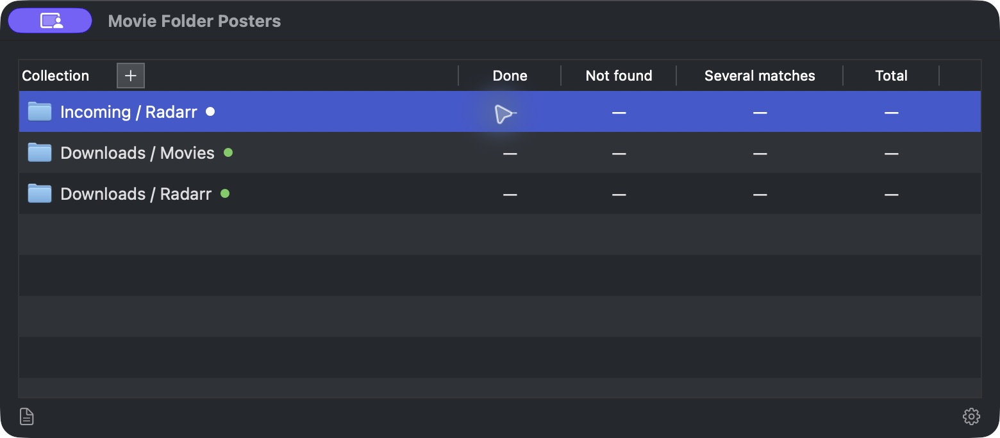
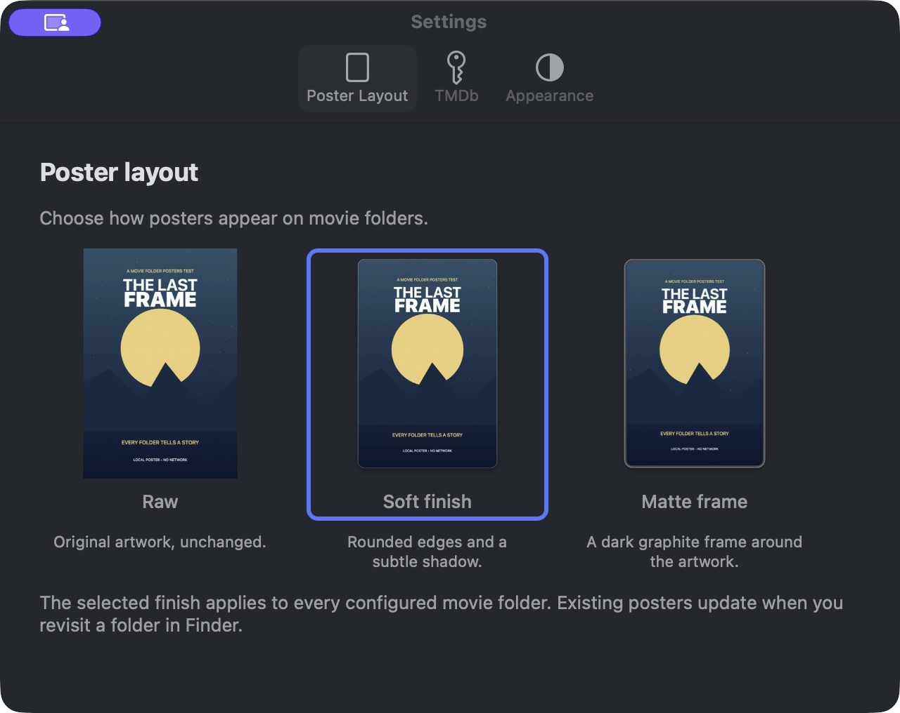
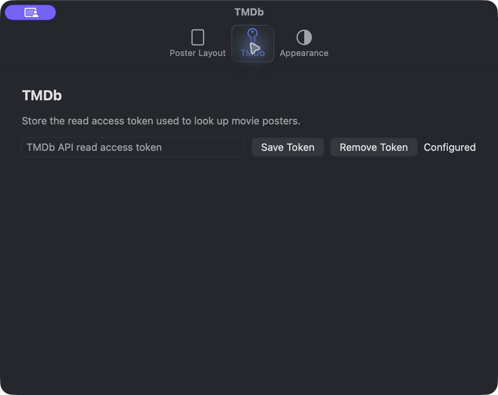
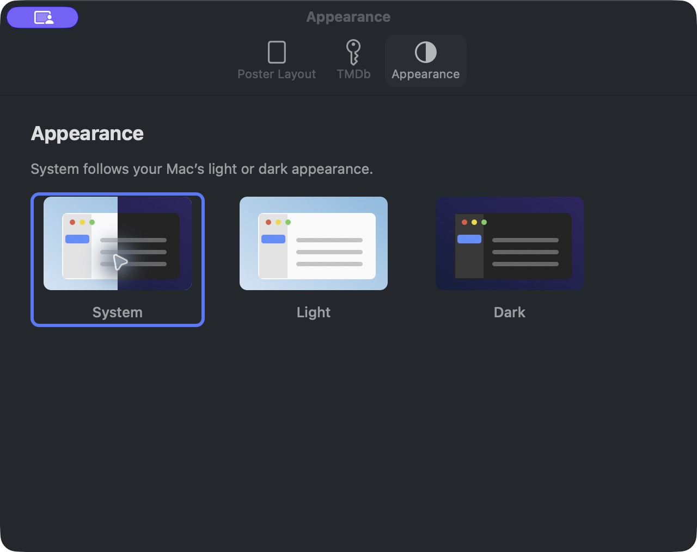
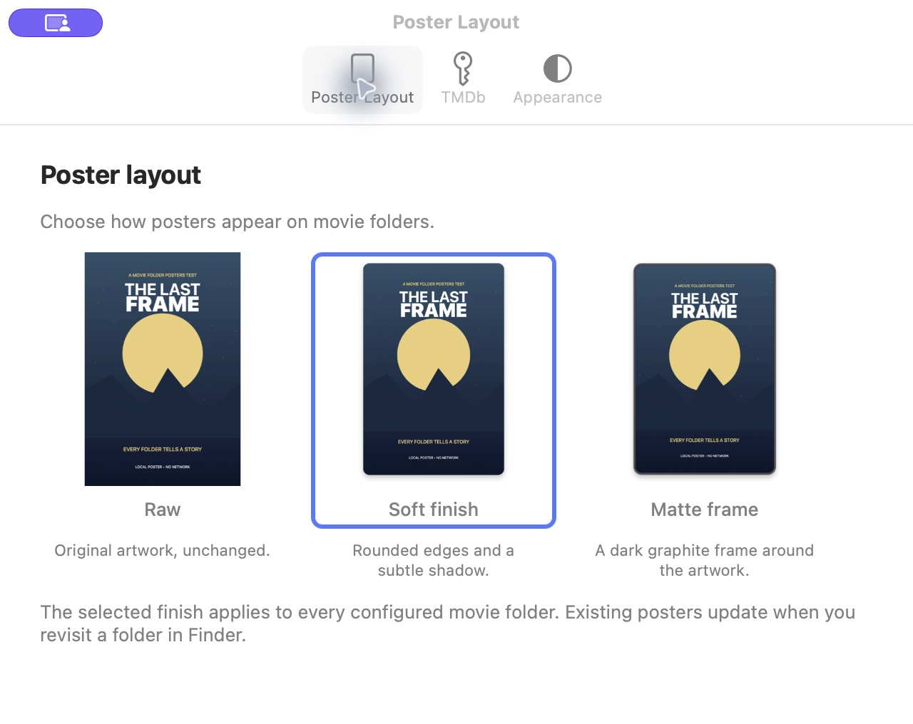
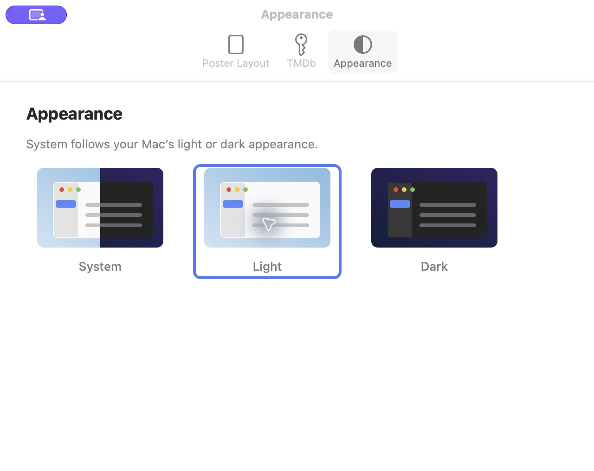
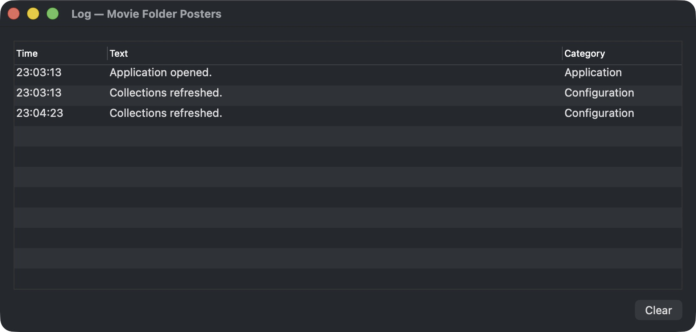

# Native AppKit UI — Transmission Reference

## Direction and scope

Retain the Main, Settings, and Log window structure. Use Transmission as the reference for native macOS
presentation, not as a reason to replace the application's flows. Keep programmatic AppKit, MVVM-C, and Swift 6.
SwiftUI is excluded. Use standard window chrome, table headers, alternating rows, selection, and controls.
Do not add custom frosted windows, glass themes, painted table frames, or glass wrappers. System-provided material
and control effects remain under macOS control. G0–G3 styling choices are retired; poster finishes are independent.

Transmission defines its layout and some custom cells; its appearance is not entirely automatic. The relevant
native reference is its preference toolbar and system table/control rendering:

- [Preference toolbar](https://github.com/transmission/transmission/blob/main/macosx/PrefsController.mm)
- [Preference window style](https://github.com/transmission/transmission/blob/main/macosx/PrefsWindow.mm)
- [Main outline view](https://github.com/transmission/transmission/blob/main/macosx/Base.lproj/MainMenu.xib)

## Main

The R100-01 candidate adds visible/accessibility access explanations to collection rows and **Check Installation…**
in the footer. Its bounded report uses a scrollable sheet attached to Main, preserving the three-window structure.
See [Installation readiness](INSTALLATION_READINESS.md) for evidence and remaining native UI checks; existing images
below precede that addition.

Main contains the Collection, Done, Not found, Several matches, and Total columns. Add is beside Collection in the
native table header. Remove appears on row hover, with equivalent keyboard and accessibility actions. Log is at
bottom left and Settings at bottom right. Refresh Status and Locate Folder remain available through the collection
context menu. Existing collection configuration actions are retained without adding a separate confirmation flow.



The native header keeps its standard drawing. A small accessibility adapter includes the embedded Add button in
its accessibility children. Column sizing accounts for the clip viewport and explicit zero intercell spacing.
Selection is preserved by collection identity across snapshot changes, rather than by row index.

## Settings

Settings is a separate, reusable window. A native icon-and-label preference toolbar switches between Poster Layout,
TMDb, and Appearance. The toolbar and active pane title follow AppKit conventions.

Poster Layout presents three selectable examples: Raw, Soft finish (default), and Matte frame. Each uses the
same bundled sample poster and the production FileSystem renderer. Short descriptions explain the differences;
a native button with an accent outline shows the saved selection. Buttons are disabled while configuration is
busy, and a failed save restores the previously saved selection.

Raw retains the artwork, Soft finish rounds the edges and adds a subtle shadow, and Matte frame adds a graphite
border that remains visible in both appearances. Preview generation uses only the bundled image; it makes no
network requests or filesystem-icon changes.



R100-06 extends TMDb with setup guidance, explicit saved-token testing, confirmed test-before-replacement and
removal, cancellation, and local identification preview. Tokens are never read back into the text field, echoed
into errors, or included in activity messages. See [credential setup](CREDENTIAL_SETUP.md) for current behavior and
qualification status. The following screenshot records the earlier baseline controls:



Appearance offers System, Light, and Dark. The host saves this choice in its own defaults and applies it to all
three windows. Selectable miniature window examples replace the popup, following the macOS Settings arrangement.
System combines light and dark halves; Light and Dark show their respective window styles. The active option has
an accent outline. This is independent of poster appearance and requires no Finder-extension configuration changes:



Light appearance references:





## Log

R110-03 extends this native window with Activity/Network sources, safe text search, separate category and severity
filters, selected-row copying and explicit source-specific Clear. Result filtering remains in the focused
Unresolved Results sheet. See [Result filtering and private history](PRIVATE_HISTORY.md) for the approved behavior
and current implementation status; the screenshots below predate these controls.

The informative Activity Log increment uses reusable constrained cells in all four columns (Time, Text, Category,
Severity), unlimited lines and automatic row heights. Resizing recalculates heights while preserving selection.
Display, search, copying and accessibility share the full rendered text. See
[Informative Activity Log](INFORMATIVE_ACTIVITY_LOG.md) for focused AppKit geometry evidence and native limitations.

Log is a separate, reusable window with native Time, Text, and Category columns and Clear at bottom right.
R100-03 replaces the session journal with shared persisted host/Finder activity, retaining at most 500 entries.
Typed events render fixed safe messages without credentials, user paths, URLs, or raw error descriptions.
Loading, empty, write failure, load failure, and Clear failure remain distinct presentation states. Clear affects
only activity history, preserving processing outcomes, matches, configuration, caches, and icons.
See [Common and Log migration](COMMON_AND_LOG_MIGRATION.md) for current implementation/verification status.



## Historical data-feed limitations after the rollback

These limitations describe the UI baseline before R100-02/R100-03. R100-02 subsequently restored authoritative
collection summaries; R100-03 implements persistent activity under the approved Common/Log package design and
awaits user review before commit/integration.

The rollback removed the previous processing-summary and shared Finder-journal wiring as well as the discarded
UI. This draft restores the window organization; it does not silently restore the removed processing integration.

- Collection-count fields support an optional summary, but the current configuration service does not populate it.
  Missing summaries display an em dash with an explanatory tooltip, never fabricated zeros.
- Log currently shows host-session events. It is not persistent and does not import Finder-extension processing
  events or historical Console messages.
- Restoring those feeds remains a separate implementation point. Do not describe this draft as a complete
  processing-status implementation merely because the columns and Log window exist.

## Verification

- 17 focused Swift Testing tests passed, including saved poster preview selection and appearance-card persistence. Added regression checks cover multiple presentation observers, separation
  of Main from credential controls, unavailable-count presentation, bounded/clearable logging, safe failure messages,
  stable selected identity after another row is removed, and trailing columns with legacy scrollbars.
- The earlier three-window baseline compiled the signed application, extension, and Xcode test targets with
  `build-for-testing`. The preview update passed the isolated Swift Testing harness and signed application build.
  XCUITest execution remains unperformed.
- The final signed Debug build launched successfully.
- Native inspection confirmed Main headers including Total, Add accessibility, native selection, Settings toolbar
  and all panes, and the separate Log window with real host-session entries.
- The preview update was inspected in the running application. All three examples, captions, selected outlines,
  and accessibility labels/states were present. Light and Dark were exercised, then System was restored.
  Poster previews were checked against light and dark backgrounds; no real poster preference was changed.
- Independent review passed after the baseline selection, column-spacing, and stale UI-test findings were resolved.
  A separate review of the preview update also passed without Important or Critical findings.
- Real folder/credential mutations and Log Clear were not exercised manually; fake-service behavior tests cover
  those state changes without changing the user's collection.
- No movie folders, icons, credentials, or poster preferences were changed during UI inspection.
- The user approved the native UI and selectable Settings previews for feature completion.
  Integrate `feature/simple-ui-design` into `develop` with `git merge --ff-only`; no push is authorized.

These are unedited native window captures. The purple remote-control badge and pointer highlight are capture-tool
artifacts, not application controls.

## Build and history

```sh
MOVIE_POSTERS_DERIVED_DATA=/tmp/MovieFolderPosters-NativeDraft ./script/build_and_run.sh --verify
```

The initial rollback left obsolete untracked experiment sources in Xcode's synchronized source folders, causing
build failures. Those ten files were preserved at `/tmp/MovieFolderPosters-DiscardedUI-03yjohnr` with a manifest.
The native Settings and Log implementations are new versions, not restored glass experiments. Temporary archives
may be removed by system cleanup. No tracked sources were deleted to resolve that initial failure.

The [first table-only baseline](images/native-appkit/first-draft.png) is historical. Earlier glass mockups remain
archived in [UI mockups](UI_MOCKUPS.md), explicitly superseded by this native direction.
