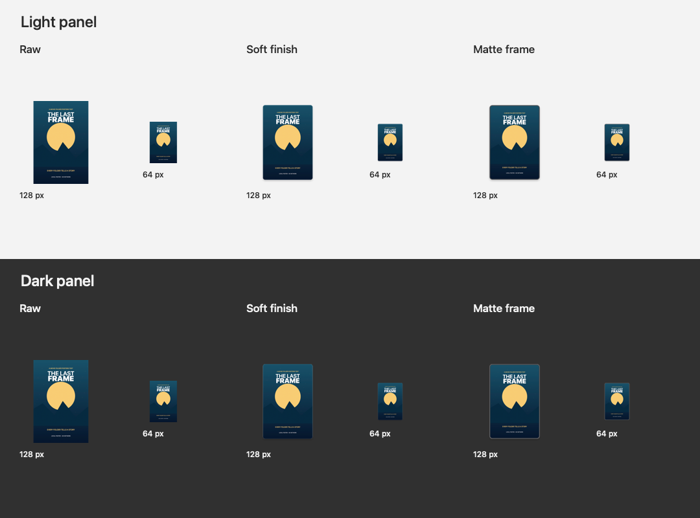

# Poster appearance

Choose the global poster finish in **Settings > Poster Layout**. It applies to every configured collection and is not
chosen while adding or editing an individual collection.

| Appearance | Rendering |
| --- | --- |
| Raw (no styling) | Original rectangular poster on a transparent square icon canvas. |
| Soft finish | Default: small rounded corners, subtle edge highlight and shadow, with transparent inset. |
| Matte frame | Rounded graphite frame with a subtle edge and shadow, visible against light and dark backgrounds. |

Poster proportions remain intact. Finder controls icon sizes and labels; small icons cannot guarantee readable poster text.
The graphite frame is fixed, so changing macOS appearance does not require another process or redraw service.

## Persistence and processing

Settings written before this feature default to Soft finish without changing configured folder authorization or credentials.
Changing appearance does not invalidate movie matches, manual selections, processing records, or downloaded source posters.
The original downloaded image stays in the cache; rendering occurs when assigning a native custom icon.

Revisit a configured collection in Finder to update existing application-owned posters from their cached source images.
Only immediate child folders are considered. Digest-verified ownership is required; unrelated or user-replaced icons and
suppressed folders remain untouched. Missing cached sources leave the current icon unchanged; **Refresh Poster** can
retrieve a new source explicitly. Cached restyling runs even while metadata requests are in backoff and requires no network.
A configured credential remains required by the existing Finder runtime to create its processor.

Manual refresh and movie selection use the selected appearance. Their processing verifier rechecks the saved collection
configuration after network work and before changing an icon. Native icons persist independently of the extension. No
watcher, timer, or extra service is introduced.

## Implementation

FileSystem owns appearance rendering and icon ownership. Its existing four-argument assignment APIs retain Raw behavior;
appearance-aware APIs take an explicit value. The main target coordinates settings and processing; the Finder extension
loads the shared selection. A transparent 512-pixel canvas carries all styles with preserved poster proportions.

Soft finish uses a 24-pixel canvas inset, 14-pixel corners, a 22% black shadow, and an 18% white inset edge.
Matte frame uses graphite #35383C, a five-pixel frame, and subtle outer and inner edges.

## Verification — 2026-10-13

- FileSystem: 44 tests passed, including pixels, transparency, aspect ratio, graphite contrast and ownership migration.
- Processing: 40 tests passed, including cached restyling, backoff, suppression, foreign icons and preserved manual matches.
- Configuration: 20 tests passed, including old-settings migration and credential/folder preservation.
- Configuration UI: eight tests passed; the isolated SwiftPM harness compiles the AppKit controller and coordinator.
- Signed Debug and Release builds passed; both complete bundle signatures verified.
- All Xcode test targets compiled successfully without launching GUI test hosts.
- Actual renderer output was visually inspected at 128 and 64 pixels on light and dark panels.
- The signed Debug host launched and remained running.

Native UI automation timed out, so clicking the selector and visually checking live Finder icons remain unverified for this
feature. Automated rendering and filesystem tests do not establish a live Finder refresh. Reboot persistence and visual
comparison within Finder still require manual checks. Xcode GUI test hosts were not launched.

Independent review passed. A removal/suppression race was corrected by requiring verified ownership and no
suppression again inside the final automatic-restyle mutation lock; its regression demonstrated RED then GREEN.
Explicit manual replacement retains its existing behavior.

## Startup layout correction — 2026-10-13

A subsequent user launch exposed an AppKit exception: the appearance help label's width constraint was activated
before the label and root view shared an ancestor. Earlier view-model tests compiled the controller but did not load
its view; process liveness alone did not establish that the configuration window could open.

The correction activates the help label's width constraint alongside the other layout constraints, after attaching
the content stack. A regression test loads the real controller view: it reproduced the same uncaught exception before
the change, then passed afterward. All nine configuration UI tests pass in the isolated SwiftPM harness.

This fix uses `bugfix/fix-appearance-layout`, branched from develop, following the clarified GitFlow convention.
The signed Debug build and `build_and_run.sh --verify` passed. Native accessibility inspection confirmed the
configuration window opened with configured directories, credential status, and Soft finish selected.
The fix was committed on the bugfix branch and merged into local develop with a non-fast-forward merge; no push.
Live Finder refresh and reboot checks remain unverified.
