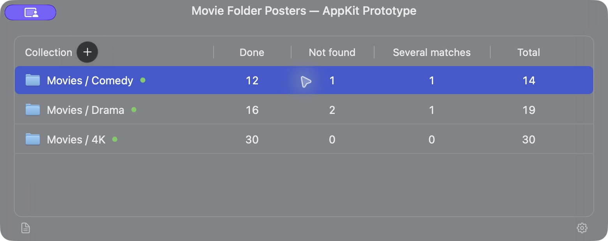
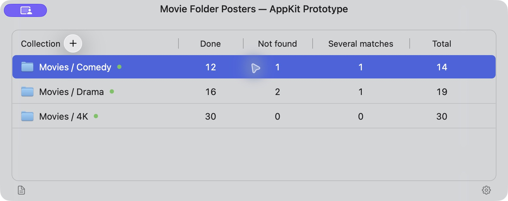

# AppKit UI Prototype — Candidate Visual References

> Historical, discarded UI direction. The current design uses native AppKit with Transmission as its reference.
> See [Native AppKit UI](NATIVE_APPKIT_UI.md). Retain these images and notes as history, not implementation targets.


Status: visual spike for review, not an approved replacement for the original mockups.

The application remains programmatic AppKit. SwiftUI is excluded. Preserve the approved Main, Settings, and Log
layouts, collection columns, footer actions, and Settings organization. This spike changes only the Main window's
typography and line treatment in an isolated application; it does not change the product implementation.

## Revised visual direction

- Keep native frosted window backgrounds and native blue rounded selection.
- Use genuine Liquid Glass selectively on appropriate controls, keeping table content in standard materials.
- Use regular 13-point table headings and 14-point body text; use a medium 15-point window title.
- Reduce the table frame to a 0.5-point stroke with separator-color alpha 0.25.
- Reduce populated-row separator alpha to 0.20. Header divider alpha is also 0.25.
- Preserve the collection layout and centered numeric columns. Footer icons remain borderless.
- Keep System / Light / Dark independent of material coverage and poster appearance.

## Native Dark appearance capture



## Native Light appearance capture



These are unedited captures of the running native application, not generated illustrations. Window-only capture
flattens the behind-window material, and the capture tool adds a remote-control badge and pointer highlight.
Use these images to inspect layout, text, control shape, and line weight. They do not establish desktop blur,
refraction, or opacity fidelity. Active/inactive material comparison has not been verified under controlled desktop
conditions. No wallpaper was embedded or composited into the prototype or these captures.

## Independent review

The independent reviewer accepted the layout and typography direction as an improved spike baseline:

- Header weight and table rules are quieter and closer to the reference.
- Numeric columns remain aligned; selection retains rounded native blue styling.
- Footer icons remain visually restrained.

Remaining differences and decisions:

- The native circular Liquid Glass Add button reads as a filled disc in Dark appearance. The original mockup uses
  a smaller, fine translucent ring. Choosing that ring treatment requires an explicit design decision; do not
  assume a different framework will change native material behavior.
- The diagnostic title suffix makes this prototype's title longer than the intended product title.
- The existing availability dots remain; they were not part of the original illustration.
- Hover-state visual fidelity was not verified by these captures.
- The quieter border may need desktop contrast review against different backgrounds.

The prototype is an improved candidate, not an exact optical match. Settings and Log retain their original design
references; no new product implementation or revised screenshot references for those windows are claimed.

## Isolation and verification

The prototype compiles copies of the Main controller, view model, theme helpers, and display models into a separate
Swift 6 AppKit application with no package dependencies. It uses three fixed sample collections and the counts
from the mockup. Mutation methods reject requests; Add and context-menu entry points are disconnected. Folder
icons use the folder content type rather than looking up user paths. No credentials, shared configuration,
network requests, or movie folders are accessed.

The native app built and launched successfully. Dark and Light appearances showed the three sample rows and all
four count columns. Independent source review passed. No unit-test pass is claimed for this throwaway visual spike;
visual rendering requires runtime inspection. A removal shortcut can show a presentation-only error from the fake
service; it performs no filesystem operation.

Temporary source and app bundle:

- `/tmp/MovieFolderPosters-AppKit-Visual-Spike/Sources/VisualSpike/`
- `/tmp/MovieFolderPosters-AppKit-Visual-Spike/MoviePosterVisualSpike.app`

To reopen the existing temporary bundle:

```sh
open -n /tmp/MovieFolderPosters-AppKit-Visual-Spike/MoviePosterVisualSpike.app
open -n /tmp/MovieFolderPosters-AppKit-Visual-Spike/MoviePosterVisualSpike.app --args --light
```

Close one prototype instance before opening the other. The temporary bundle may be removed by system cleanup;
these screenshots and the documented styling decisions are the durable results. The prototype is left in Light
appearance for review. No product files were modified and nothing was committed.

## Original references

See [UI mockups](UI_MOCKUPS.md) for the unchanged Main, Settings, and Log illustrations.
