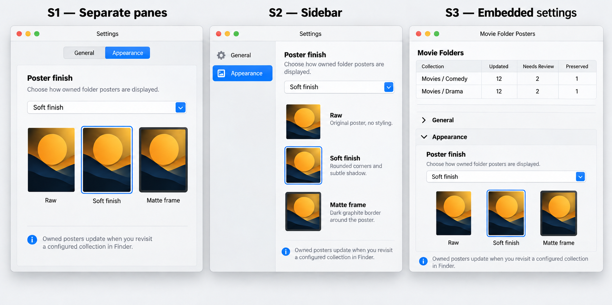
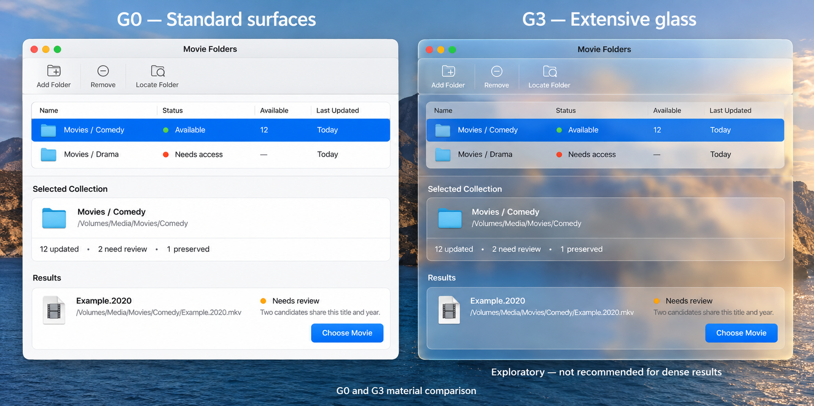
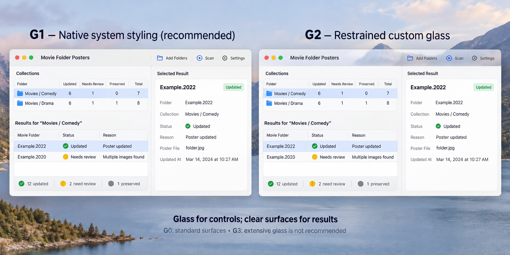
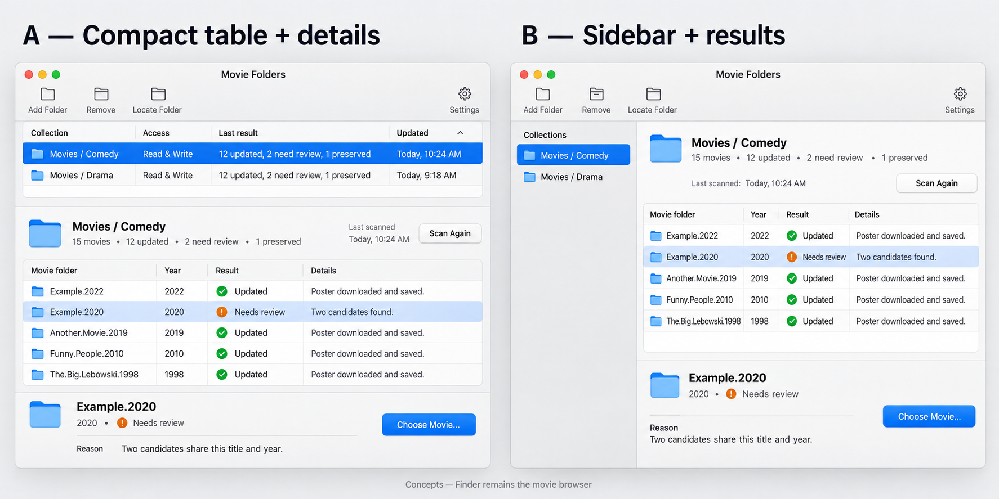
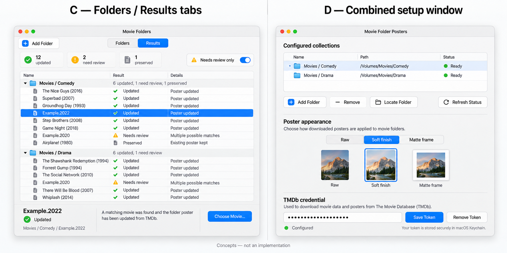

# UI design proposals

Date: 2026-10-14
Status: Design consultation and alternatives; no layout selected or implementation authorized.

## Design brief

Movie Folder Posters is a native AppKit utility that assigns persistent movie poster icons to authorized folders.
Finder remains the movie browser. The host provides collection setup, preferences, processing feedback, and repairs.
Keep MVVM-C, local in-process services, modest resource use, and event-driven processing.

The current host combines a configured-directory table, folder access actions, a secure TMDb token field, and a global
poster appearance selector. Processing explanations are not yet exposed in the interface. The proposals below include
possible new result surfaces and actions; they do not claim those capabilities already exist.

A **collection** is a configured parent directory. A **result** describes processing one immediate child movie folder.
Do not confuse collection access status with the outcome of matching an individual movie.
All names and counts in the wireframes are illustrative, not current processing measurements.

## Design agent recommendation

Prefer a compact **Movie Folders** window with collection rows and selected-collection details, plus a separate
**Settings** window for credentials and global poster appearance. Native system styling is sufficient; custom Liquid
Glass is optional. Make unresolved outcomes understandable and actionable before adding decorative effects.

Use a dedicated detail pane instead if child-level explanations regularly require more space. Avoid a poster gallery,
movie-library navigation, or a dashboard full of decorative cards.

## Main window alternatives

### A — Collection table with expandable details: recommended

```text
Movie Folders                         [Add Folder] [Remove] [Locate Folder]

Collection                  Access           Last result          Updated
Movies / Comedy             Available        12 updated           Today
Movies / Drama              Needs access     Not processed        —

Selected collection: Movies / Comedy
12 updated · 2 need review · 1 preserved
[Show results]                                      [Process collection]

Expanded results:
Child folder                 Outcome          Explanation           Action
Example.2022                 Updated          Confirmed match       Inspect
Example.2020                 Needs review     Two plausible movies  Choose Movie…
```

The upper table manages configured roots. A disclosure area below it reveals child outcomes for the selected root.
A selected result can expose detected title/year, confirmed identity, recorded evidence, and the applicable repair.

**Strengths:** Compact; builds on the existing folder-centric UI; keeps access and processing context together.
**Tradeoffs:** Long result lists need scrolling and filtering. Keep the distinction between collection and child clear.
**Best fit:** A small utility with a handful of configured collections and occasional diagnostic work.

### B — Collection sidebar and dedicated results pane

```text
Movie Folders                                                    [Add Folder]
+-------------------------+------------------------------------------------+
| Collections             | Movies / Comedy                                |
| Movies / Comedy         | Available · Last processed today               |
| Movies / Drama          | 12 updated · 2 need review                     |
|                         |                                                |
|                         | Results                     [Needs review v]   |
|                         | Example.2022                Updated            |
|                         | Example.2020                Needs review       |
|                         |                                                |
|                         | Selected result                                |
|                         | Two candidates share this title and year.      |
|                         | [Choose Movie…]                                |
+-------------------------+------------------------------------------------+
```

The left pane contains authorized collection roots. The right pane contains their outcomes and selected-result details.
Use text-oriented rows; a small poster in a candidate-selection sheet supports a decision rather than browsing.

**Strengths:** Strong parent/child separation; more room for evidence, filters, and longer explanations.
**Tradeoffs:** Larger minimum window size; more empty space when collections or results are few.
**Best fit:** Users who frequently resolve problematic folders or manage several collections.

### C — Folders and Results tabs

```text
Movie Folders
[Folders] [Results]

Folders: configured collection table, access status, and authorization actions.
Results: recorded outcomes grouped by collection, with filters and corrective actions.
```

Folders owns configuration and access. Results owns operational outcomes, timestamps, and explanations.
Moving from a result back to its collection must retain selection and context.

**Strengths:** Results can grow independently; a cross-collection operational overview has room for filters.
**Tradeoffs:** Extra navigation; the user may lose collection context or interpret Results as a separate media library.
**Best fit:** Only when cross-collection review is a demonstrated requirement. Avoid adopting tabs merely for future growth.

### D — Compact single-window configuration form

```text
Movie Folder Posters

Configured collections
[Collection table with access status]
[Add Folder] [Remove] [Locate Folder] [Refresh Status]

Poster appearance
[Raw] [Soft finish] [Matte frame]
[Representative preview]

TMDb credential
[Secure token field] [Save Token] [Remove Token]
```

Keep global settings and collection configuration together, close to the current interface.
A result sheet could open from a collection row, without adding a permanent detail pane.

**Strengths:** Minimal navigation; straightforward for infrequent setup; smallest redesign.
**Tradeoffs:** Global preferences compete with operations; detailed outcomes have limited space.
**Best fit:** If the host stays primarily a setup utility and diagnostic use is uncommon.

### Layout comparison

| Option | Compactness | Space for explanations | Separate Settings | Main tradeoff |
| --- | --- | --- | --- | --- |
| A: table and disclosure | High | Moderate | Recommended | Long results need careful expansion. |
| B: sidebar and detail | Moderate | High | Recommended | Larger window for a small utility. |
| C: Folders / Results tabs | Moderate | High | Recommended | More navigation and weaker immediate context. |
| D: combined form | High | Low | Optional | Settings compete with troubleshooting. |

## Settings alternatives

### S1 — Two-pane Settings window: recommended

Open through **Movie Folder Posters → Settings…** and **Command-comma**. Present one Settings window rather than
creating multiple copies. Keep collection-specific access repair in the main window.

```text
Settings
[General] [Appearance]

General
TMDb API read access token
[Secure field] [Save Token] [Remove Token]
Configured / Not configured
[Credential setup guidance]

Appearance
Poster finish: [Raw (no styling) v]
[Raw preview] [Soft preview] [Matte preview]
Default: Soft finish
Existing owned posters update when a configured collection is revisited.
```

Use explicit labels, secure entry, and honest saved state. A reveal-token control and validation action are optional
new features requiring separate approval. Avoid displaying an already stored credential just to decorate Settings.
The preview illustrates rendering; it must not silently modify real folder icons.

**Strengths:** Familiar and compact; separates operational work from global preferences.
**Tradeoffs:** Users navigate to another window for initial setup or changing appearance.

### S2 — Settings sidebar

A small sidebar selects General and Appearance, leaving more room for help and style previews.

**Strengths:** Supports longer explanatory content and future approved sections.
**Tradeoffs:** Excess weight for only two sections; do not invent empty tabs or panels.
**Best fit:** When actual settings outgrow the compact two-pane design.

### S3 — Embedded settings disclosure

Keep credential and appearance sections collapsed below the collection table, expanding only when needed.

**Strengths:** One window and little navigation.
**Tradeoffs:** Shares space with results and makes keyboard/focus behavior more complex.
**Best fit:** Option D, if an independent Settings window is intentionally deferred.

## Liquid Glass alternatives

Liquid Glass is a presentation choice, not a requirement for this app. Retain AppKit throughout; adoption does not
require SwiftUI. Platform/API availability and behavior must be checked against the chosen deployment target before
implementation. The comparison describes design intentions, not an already validated custom-glass implementation.

| Tier | Proposal | Benefits | Costs and concerns | Recommendation |
| --- | --- | --- | --- | --- |
| G0: standard content surfaces | Native controls and readable standard table/form backgrounds. | Clear, restrained, familiar. | Little bespoke visual identity. | Suitable baseline; no promise to override OS chrome. |
| G1: native system appearance | Use standard AppKit toolbar, controls, and window chrome. | Modern OS appearance with little custom code. | Appearance varies with macOS and accessibility settings. | Recommended with A or B. |
| G2: restrained custom glass | Optional glass for a small top-level navigation/control region. | Adds emphasis where navigation benefits. | Requires visual, accessibility, and performance verification. | Explore only after functional layout works. |
| G3: extensive glass treatment | Translucent cards, forms, results, and layered effects throughout. | Strong stylistic statement. | Competes with explanations and dense status text. | Poor fit for this utility. |

For G1 or G2, keep poster previews as artwork, and table content and rejection explanations on calm surfaces.
Do not put text-heavy result panels on elaborate moving or layered backdrops. Avoid stacking custom effects on controls
that already receive system treatment. Do not introduce a theme watcher or recurring redraw service.

Apple guidance supports using Liquid Glass for functional controls and navigation, with restraint around content:

- [Adopting Liquid Glass](https://developer.apple.com/documentation/technologyoverviews/adopting-liquid-glass)
- [Materials guidelines](https://developer.apple.com/design/human-interface-guidelines/materials)
- [Build an AppKit app with the new design](https://developer.apple.com/videos/play/wwdc2025/310/)
- [NSGlassEffectView](https://developer.apple.com/documentation/appkit/nsglasseffectview)
- [Settings guidelines](https://developer.apple.com/design/human-interface-guidelines/settings)

## Shared visual and interaction principles

- Use system typography, readable row spacing, consistent labels, and modest grouping.
- Distinguish **Available** access from **Updated**, **Needs review**, **Preserved**, and **Failed** processing outcomes.
- Show why processing stopped and the relevant next action; do not imply that a rejected match was applied.
- Keep existing directory authorization and ownership protections regardless of layout.
- Show progress only for actual active work; opening a report must not itself trigger network requests or icon writes.
- Selectively expose Retry, Choose Movie, Locate Folder, or Inspect according to supported result states.
- Preserve the selected collection and child result after refresh, when those records still exist.
- Use bounded recorded outcomes rather than live polling. Present their timestamp so stale data is understandable.
- Use sheets for focused movie-selection or confirmation tasks rather than another full browsing window.
- Keep poster styles independent of window materials. A glass toolbar does not imply a glass folder icon.

## Empty, error, and busy states

| State | Presentation |
| --- | --- |
| No collections | Brief purpose statement and one Add Folder action. |
| No recorded results | Explain that no completed run is recorded; avoid claiming all folders succeeded. |
| Access unavailable | Show the affected collection and the specific recovery when known. |
| Ambiguous match | Show competing candidates only on request and offer Choose Movie. |
| Year/title mismatch | Explain the conflicting evidence; never silently relax the policy in the UI. |
| Network backoff | Show the recorded reason and retry eligibility, distinct from active progress. |
| Mutation in progress | Indicate the operation, prevent conflicting actions, and retain focus. |
| Settings save failed | Restore or clearly mark saved state and show an actionable error. |

## Accessibility and verification expectations

Provide keyboard paths for every action, meaningful VoiceOver labels, and text alongside status colors and icons.
Preserve focus after adding, removing, retrying, or dismissing a sheet. Announce asynchronous outcomes without excessive
interruptions. Check light and dark appearance, increased contrast, reduced transparency, narrow windows, and long paths.

Any selected redesign needs tests that load actual views and exercise window lifecycle. Compilation and process liveness
alone do not establish that AppKit constraints are valid or that the window opened. Verify resizing, reopening, Settings
presentation, and the visible distinction between saved settings and preview-only changes.

## Decisions still open

1. Choose the primary layout: A, B, C, or D.
2. Decide whether separate Settings ships with the first UI iteration: S1, S2, or S3.
3. Choose the material approach: G1 is recommended; G2 remains an optional later experiment.
4. Select which result information and corrective actions the first iteration actually supports.
5. Decide whether a future visual mockup is needed before reviewing a concrete implementation proposal.

Recommended combination: **A + S1 + G1**, with **B + S1 + G1** as the alternative for deeper troubleshooting.
This recommendation does not approve implementation or select features from the catalogues below.

## Related documents

- [80 enhancement ideas](ENHANCEMENT_IDEAS.md)
- [100 new feature ideas](NEW_FEATURE_IDEAS.md)
- [Current project plan](PROJECT_PLAN.md)
- [Poster appearance behavior and startup correction](POSTER_APPEARANCE.md)

## Visual concept comparisons — 2026-10-14

These generated images illustrate layout and material alternatives. They are not running app screenshots, exact
AppKit renderings, accessibility evidence, or approved implementation specifications. Sample counts, file labels,
buttons, and detail fields are illustrative. The written scope and safeguards above remain authoritative.
Actual OS glass appearance depends on macOS, desktop background, and accessibility settings.

### Settings: S1, S2, S3

S1 separates preferences into panes; S2 uses a Settings sidebar; S3 embeds preferences in the main window.
The corrected preview keeps poster artwork sharp and distinguishes a graphite frame from an image texture.



### Materials: G0 and G3

G0 uses standard surfaces. G3 deliberately explores extensive glass to show its visual impact on dense information.
G3 remains an exploratory option, not the recommended treatment for operational results.



### Materials: G1 and G2

G1 relies on native system styling. G2 demonstrates a restrained custom-glass toolbar with calmer content surfaces.
These can be combined with a separately chosen Settings layout; the boards do not depict every cross-combination.



### Additional main-window comparisons

These supplementary boards illustrate the previously proposed main-window layouts A through D.
Styling and sample artwork in them are illustrative; use the corrected Settings board and the actual poster renderer
preview in [Poster appearance](POSTER_APPEARANCE.md) to assess the implemented poster finishes.




