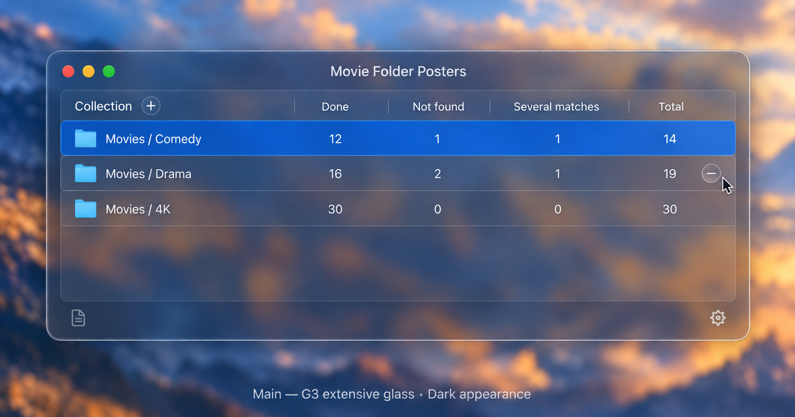
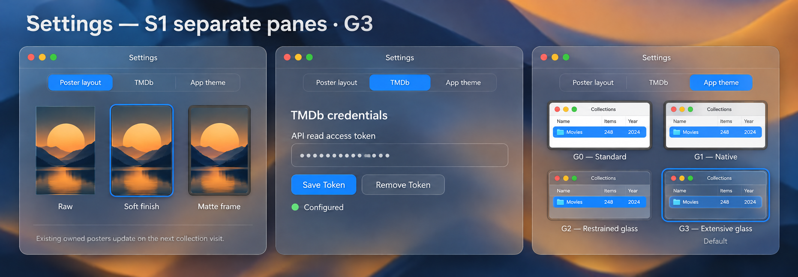
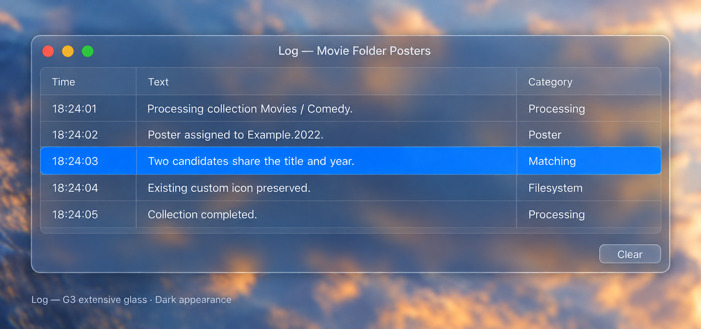

# UI Mockups

> Historical, discarded UI direction. The current design uses native AppKit with Transmission as its reference.
> See [Native AppKit UI](NATIVE_APPKIT_UI.md). Retain these images and notes as history, not implementation targets.

These are the approved visual references for Movie Folder Posters. They are design mockups, not screenshots of
finished software. Use them when reviewing future UI work alongside the requirements below.

## Main window — G3

A simple collection list with Done, Not found, Several matches, and Total columns. Place Add beside Collection,
show Remove only while hovering over a row, and place Log at bottom left and Settings at bottom right.

## Settings — S1 separate panes, G3

Separate Poster layout, TMDb, and App theme panes. Poster options are Raw, Soft finish (default), and graphite
Matte frame. App theme includes G0–G3 examples, with G3 as the default.

System, Light, and Dark appearance selection and visual examples were approved after this mockup was created;
retain that requirement even though it is not shown here.

## Log window — G3

Use the same collection-table visual language for Time, Text, and Category, with Clear at bottom right.

## Material interpretation and verification

Preserve the approved layout and translucent aesthetic. Use standard frosted materials for window backgrounds
and table content, and apply genuine Liquid Glass selectively to appropriate controls and navigation.

The current implementation has not achieved visual acceptance. Desktop review identified darker and heavier
surfaces, overly prominent table borders and separators, heavier typography, and a darker Add button than these
references. Build and test success does not establish visual fidelity. Do not treat the implementation as the
replacement visual reference or assume that switching UI frameworks would resolve these differences.

## Native AppKit candidate references

The [isolated Main-window prototype](UI_APPKIT_PROTOTYPE.md) contains actual Dark and Light captures, the revised
material treatment, and independent review findings. These are candidates for review, not approved replacements
for the original illustrations above.

## Related documentation

- [UI design proposals and earlier alternatives](UI_DESIGN_PROPOSALS.md)
- [UI implementation and verification](SIMPLE_UI_IMPLEMENTATION.md)
- [Poster appearance](POSTER_APPEARANCE.md)
